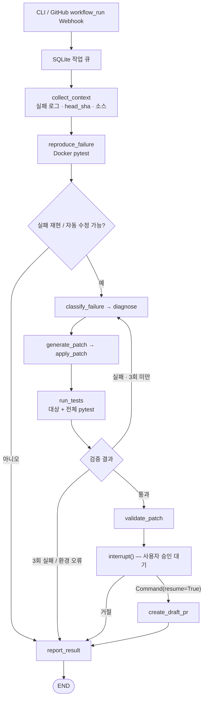

# PatchPilot 🛠️

**GitHub Actions CI 실패를 분석하고, 코드를 수정하고, 격리된 pytest로 재검증하는 LangGraph 기반 AI Agent**

> **학습·시연 목적의 MVP** · Python 3.11+ / pytest · 실패 감지부터 사람의 승인까지 연결하는 stateful repair workflow

[](https://github.com/ii2001/PatchPilot/actions/workflows/ci.yml)
[](https://www.python.org/)
[](https://docs.langchain.com/oss/python/langgraph/overview)

**[프로젝트 보고서](docs/project-report.md)** · [아키텍처 상세](docs/architecture.md) · [실제 수리 시연 기록](docs/self-repair.md) · [보안 및 제약](docs/security.md)

## 1. 왜 만들었나?

PR을 올리고 CI가 실패하면 개발자는 로그 확인 → 원인 분석 → 코드 수정 → 테스트 → 재푸시를 반복한다. PatchPilot은 이 반복 과정을 AI Agent 워크플로로 구조화한 프로젝트다.

**핵심 목표는 범용 자동수정 제품 출시가 아니라, LangGraph의 상태 공유·조건 분기·반복 실행·체크포인트·Human-in-the-Loop를 실제 CI 문제에 적용하는 것**이다.

| 입력 | PatchPilot이 하는 일 | 출력 |
| --- | --- | --- |
| 실패한 GitHub Actions Run ID | 로그·정확한 Commit 수집 → Docker 실패 재현 → LLM 분류/진단/수정 → pytest 검증 | 오류 원인, 수정 Diff, 실행·테스트 기록, 승인 대기 상태 |
| 승인된 수정 결과 | 검증 내용을 재확인하고 GitHub API로 수정 브랜치 및 Draft PR 발행 | Draft PR URL과 별도의 원격 CI 상태 |

자동 Merge는 하지 않는다. 현재 버전은 **기존 PR에 직접 Commit을 추가하는 방식이 아니라, 실패 Run의 기준 브랜치를 대상으로 새 Draft PR을 제안하는 방식**이다.

## 2. 전체 동작 흐름



**LangGraph 사용 지점**

| 기능 | 코드 | 목적 |
| --- | --- | --- |
| `StateGraph` 및 노드 연결 | [`graph.py`](src/patchpilot/graph.py) | 수리 절차를 상태 기반 그래프로 구성 |
| `RepairState` (Pydantic) | [`state.py`](src/patchpilot/state.py) | 로그, 진단, 패치, 시도 횟수, 검증 이력 공유 |
| Conditional Edges | [`graph.py`](src/patchpilot/graph.py) | 성공/실패/수동 조치 라우팅 |
| Repair Cycle | [`nodes.py`](src/patchpilot/nodes.py) | 최신 실패 피드백으로 **최대 3회** 재진단 |
| SQLite Checkpointer | [`service.py`](src/patchpilot/service.py) | 승인 대기·중단된 실행 상태 저장 |
| `interrupt()` / `Command(resume=...)` | [`graph.py`](src/patchpilot/graph.py), [`service.py`](src/patchpilot/service.py) | 사람의 승인 후 작업 재개 |

LLM은 분류·진단·수정 **제안**을 담당한다. 테스트 합격, 수정 범위, 재시도 제한, 발행 승인 판단은 결정론적 로직이 통제한다.

## 3. 주요 기능 및 기술

- **GitHub Actions 분석:** 실패 Run/Job/Step 로그 조회, 정확한 `head_sha`의 Git blob 검증, 허용 저장소 제한
- **LLM 기반 수정:** LangChain `ChatOpenAI` + Pydantic Structured Output, 이전 실패·수정 이력 활용, 유일하게 일치하는 부분 문자열을 안전한 전체 파일 Patch로 변환
- **격리 테스트:** Docker의 제한된 컨테이너에서 실제 pytest 수행, 대상 테스트와 전체 테스트 결과·Exit Code·Workspace Digest 기록
- **수정 정책:** 테스트·CI·Git·pytest 설정 파일 변경 제한, 파일 추가/삭제 미지원, 기본 **3개 파일·100줄·3회 시도** 한도
- **HITL 승인:** 검증된 Diff를 확인한 후 명시적 승인 시 Draft PR 생성 시도, 거절·발행 실패·재개 처리
- **선택적 자동 감지:** GitHub Webhook(HMAC 검증) → SQLite Queue → 별도 Worker
- **검증 수준 분리:** Mock 실행, 로컬 Docker 검증, 실제 GitHub CI 검증을 각각 다른 상태로 기록

| 계층 | 사용 기술 |
| --- | --- |
| Agent | Python 3.11+, LangGraph, LangChain, OpenAI API, Pydantic |
| 외부 연동 | GitHub REST API, httpx, GitHub Actions, FastAPI Webhook |
| 실행·상태 | Docker, pytest, SQLite / LangGraph SQLite Checkpointer |
| 테스트·패키징 | pytest, setuptools, GitHub Actions CI |

## 4. 빠른 시작 — API 키 없이 Mock 실행

```bash
git clone https://github.com/ii2001/PatchPilot.git
cd PatchPilot
python3 -m venv .venv
source .venv/bin/activate
python -m pip install -e ".[dev,webhook]"

python -m patchpilot demo
python -m patchpilot demo --scenario retry_success
python -m pytest -q
```

Mock 데모에는 성공, 재시도 후 성공, 3회 실패, 환경 오류, 재현 실패의 **5개 시나리오**가 있다. `simulated: true`는 실제 저장소 코드 실행이나 수리 성공을 의미하지 않는다.

## 5. 실제 Python 프로젝트의 CI 수리

**전제:** 지원 범위 내 Python/pytest 저장소, 완료된 실패 Workflow Run, GitHub 접근 토큰, OpenAI API 키, 검토한 불변 Docker 이미지가 필요하다. API 사용에는 별도 요금이 발생할 수 있다.

### 5.1 환경 설정

```bash
cp .env.example .env
# .env 파일에 실제 키와 허용 저장소를 직접 설정한다.
# 환경변수 파일은 자동으로 로드되지 않는다.
set -a
. ./.env
set +a
```

주요 변수:

| 변수 | 설명 |
| --- | --- |
| `GITHUB_TOKEN` | 허용 저장소의 Actions: read, Contents: read/write, Pull requests: read/write |
| `OPENAI_API_KEY` | 실제 LLM API 키 |
| `PATCHPILOT_OPENAI_MODEL` | Structured Output 지원·계정 사용 가능 모델 (예시 파일에 테스트 프로필 제공) |
| `PATCHPILOT_REASONING_EFFORT` | 지원 모델에서만 사용하는 선택적 추론 설정 |
| `PATCHPILOT_ALLOWED_REPOS` | 쉼표로 구분된 허용 저장소 (예: `owner/example`) |
| `PATCHPILOT_SANDBOX_IMAGE` | 검토하고 고정한 Docker 이미지 ID 또는 digest |
| `PATCHPILOT_DATA_DIR` | 작업·체크포인트·LLM 캐시 저장 경로 |

모든 옵션은 [`.env.example`](.env.example)을 참고한다. **토큰을 Git에 Commit하지 말고**, 소스코드·CI 로그가 모델 API에 전달된다는 점을 고려해 허용된 저장소에서만 실행한다.

### 5.2 Sandbox 준비

일반적인 Python/pytest 데모용 신뢰 이미지:

```bash
docker build -t patchpilot-sandbox:local docker
export PATCHPILOT_SANDBOX_IMAGE="$(docker image inspect patchpilot-sandbox:local --format '{{.Id}}')"
```

PatchPilot **자체 저장소**를 수리할 때는 LangGraph 등 추가 의존성이 필요하므로 [전용 이미지 및 시연 가이드](docs/self-repair.md)에 따라 `docker/Dockerfile.patchpilot`을 사용한다. 대상 저장소의 임의 `requirements.txt`를 실행 중 자동 설치하지 않는다.

### 5.3 실행·승인

```bash
patchpilot repair --repo owner/example --run-id 123456789
patchpilot status --job-id JOB_ID
# 원인 · Diff · 테스트 결과를 검토한 뒤
patchpilot approve --job-id JOB_ID
# 또는 거절
patchpilot reject --job-id JOB_ID
```

`repair`가 정상적으로 수정안을 검증하면 `AWAITING_APPROVAL`로 중단한다. `approve`는 SQLite 체크포인트에서 **테스트/LLM을 반복하지 않고** 승인된 발행 단계로 재개한다. 발행 중 권한 문제 등이 있으면 `PUBLISH_FAILED`가 되며, 조건이 해결된 뒤 같은 Job ID로 발행 재시도가 가능하다.

### 5.4 선택적 Webhook / Worker

별도 서버의 HTTPS 엔드포인트 `/webhooks/github`에 GitHub **Workflow runs** 이벤트를 등록한다. Webhook Secret은 `PATCHPILOT_WEBHOOK_SECRET`에 설정한다.

```bash
uvicorn patchpilot.webhook:create_app --factory --host 127.0.0.1 --port 8000
# 다른 프로세스에서
patchpilot worker
```

서버·Worker는 같은 데이터 디렉터리를 사용해야 한다. 외부 접근 시 HTTPS reverse proxy가 필요하다. CLI 수동 실행에는 Webhook이 필요 없다.

## 6. 검증된 결과 (2026-10-12 기준)

**개발 CI:** [main GitHub Actions 실행 #38215981498](https://github.com/ii2001/PatchPilot/actions/runs/38215981498)에서 실제 로그 기준 **134 passed / 13 skipped / 0 failed**. Mock 데모와 배포 패키지 빌드도 성공했다. 기본 CI의 Skip에는 opt-in Docker·외부 API 테스트가 포함된다.

**실제 자동 수정 시연:** [의도적으로 실패시킨 Run #38213983578](https://github.com/ii2001/PatchPilot/actions/runs/38213983578)을 대상으로, 프로젝트 기록상 실제 OpenAI 호출과 Docker 테스트를 이용해 `src/patchpilot/policy.py`의 잘못된 비교 연산자 한 줄을 1회 수정했다. 수정 후 **Docker 대상 테스트 29 passed, 전체 126 passed / 13 skipped**가 기록되었다.

**검증 경계:** 해당 수리 실행은 사용자 승인 이후 실제 Draft PR 발행 단계에서 **GitHub 토큰의 `Contents: write` 권한 부족(HTTP 403)**으로 멈췄다. 따라서 **실제 Draft PR 생성 및 그 PR의 원격 CI 통과는 미검증**이다. PR 생성 로직 자체는 모의 GitHub API 테스트로 검증했다.

실험 증거·수정 전후 Diff·한계는 [프로젝트 보고서](docs/project-report.md)와 [자체 복구 기록](docs/self-repair.md)을 참고한다.

## 7. 현재 지원 범위 및 안전성

| 지원 | 제한 |
| --- | --- |
| Python 3.11+ / pytest 중심 | Java/Spring/Vue 등 미지원 |
| 최대 200개 파일, 총 1 MB UTF-8 텍스트 | Binary·Symlink·Submodule 제외 |
| 기존 Python 소스 파일 수정 | 파일 추가·삭제, 테스트/CI 설정 수정 불가 |
| Docker 격리 실행 | 임의 의존성 설치 및 Secret 기반 테스트 불가 |
| 로컬 Docker 검증 / 발행 후 CI 조회 | 자동 Merge, 범용 GitHub App 설치 기능 미지원 |

Docker는 완전한 악성 코드 방어 경계가 아니다. 격리된 전용 호스트 사용과 **사람의 코드 리뷰**가 권장된다. 로컬 테스트 통과는 의미적 정답이나 GitHub의 모든 required checks 통과를 보장하지 않는다.

## 8. 저장소 구조

```text
PatchPilot/
├── src/patchpilot/
│   ├── state.py, graph.py, nodes.py    # LangGraph 상태·흐름·노드
│   ├── llm.py, github.py               # 외부 LLM / GitHub API
│   ├── docker_runner.py, policy.py     # 격리 실행 / 수정 정책
│   ├── verification.py, reporting.py   # 최종 검증 / 보고
│   ├── service.py, storage.py          # 승인·실행·영속 상태
│   └── webhook.py, __main__.py         # 자동 이벤트 / CLI
├── docker/                             # 격리 실행 harness 및 이미지
├── tests/                              # Unit / Mock / Docker / opt-in Live
├── examples/failing_pytest_demo/       # 교육용 실패 시나리오
├── docs/                               # 보고서·아키텍처·보안·검증 기록
├── .github/workflows/ci.yml           # 프로젝트 자체 CI
└── pyproject.toml
```

## 9. 더 읽어보기

- **[프로젝트 보고서](docs/project-report.md)** — 문제 정의, 요구사항, LangGraph 설계, 구현, 실험, 한계
- [상세 아키텍처](docs/architecture.md) — 실행 경계, state/checkpoint, 멱등성
- [자체 복구 실험](docs/self-repair.md) — 실제 실패 Run, 수정 내용, PR 권한 오류
- [기존 테스트 검증 기록](docs/validation.md) — MVP 초기 통합 테스트 내역 (이후 Live 시연은 `self-repair.md` 참조)
- [보안 정책](docs/security.md) — Sandbox·파일 정책·지원 범위
- [실습용 오류 프로젝트](examples/failing_pytest_demo/README.md) — 테스트별 재현 방법

---

**PatchPilot은 안전한 자동 수정의 가능성을 실습한 LangGraph 학습 프로젝트다.** 실제 동작의 성공 범위와 미검증 범위를 구분해서 기록한다.
