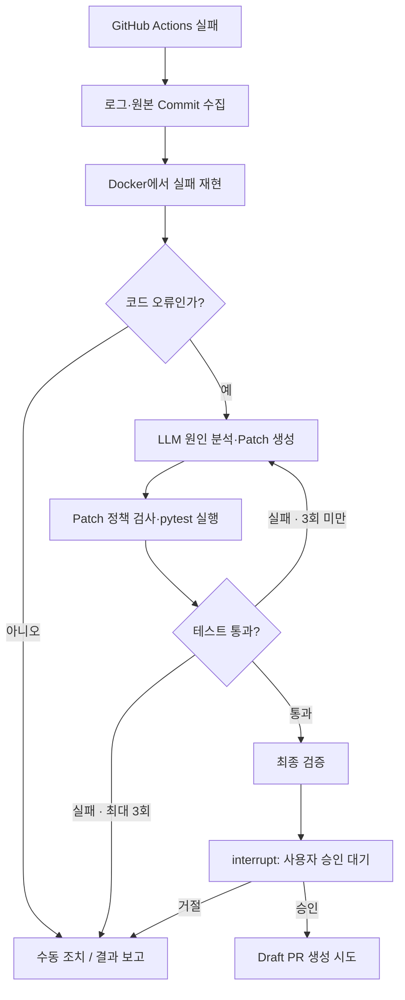

# PatchPilot 🛠️

**GitHub Actions에서 실패한 Python 테스트를 분석·수정·재검증하는 LangGraph AI Agent**

[](https://github.com/ii2001/PatchPilot/actions/workflows/ci.yml)
[프로젝트 보고서](docs/project-report.md) · [실제 복구 실험](docs/self-repair.md)

## 왜 만들었나?

PR을 올린 뒤 CI가 실패하면 개발자는 **로그 확인 → 원인 분석 → 코드 수정 → 다시 Push → CI 재확인**을 반복한다. 단순한 pytest 오류여도 사람이 매번 전체 과정을 수행해야 한다.

**PatchPilot은 그 반복 작업을 AI Agent에 맡기되, 최종 코드 반영 권한은 사람에게 남겨두기 위해** 만들었다. 단순히 오류를 설명하는 것이 아니라 **수정안을 만들고 실제 테스트로 검증**한 뒤, 승인을 받아 Draft PR로 제안하는 것이 목표다.

> **프로젝트 성격:** SKALA LangGraph 학습·시연용 MVP. 범용 자동수정 서비스가 아니며, 현재는 기존 PR을 직접 고치지 않고 별도의 Draft PR을 제안한다.

## 어떻게 동작하나?



### 왜 LangGraph인가?

CI 복구에는 한 번의 LLM 호출보다 **실패 결과를 보고 다시 진단하는 반복 실행**이 필요하다.

| 설계 선택 | 왜 필요한가? |
| --- | --- |
| **StateGraph + RepairState** | 로그·수정 이력·테스트 결과를 노드 간에 공유하려고 |
| **Conditional Edges** | 테스트 결과에 따라 재시도·성공·중단을 명확히 분기하려고 |
| **최대 3회 Cycle** | 실패를 피드백하되 무한 수정과 비용 낭비를 막으려고 |
| **SQLite Checkpointer** | 승인을 기다리는 동안 중단한 상태를 보존하려고 |
| **`interrupt()` / `Command(resume)`** | AI의 제안과 실제 GitHub 쓰기 권한을 분리하려고 |

LLM은 **원인 분석과 수정 제안**만 담당한다. 테스트 합격·변경 허용 범위·재시도 판단은 코드가 검증한다.

## 왜 이렇게 검증하나?

- **정확한 Commit SHA:** 지금의 코드가 아닌 **CI가 실패했던 코드**를 재현해야 원인을 잘못 판단하지 않는다.
- **Docker 격리 테스트:** 외부 저장소의 pytest를 호스트에서 직접 실행하지 않고, 대상·전체 테스트 결과를 확인한다.
- **수정 제한:** 테스트나 CI 설정을 바꿔 억지로 성공시키지 못하게 한다. 기본 한도는 **3개 파일 / 100줄 / 3회 시도**다.
- **Human-in-the-Loop:** 로컬 테스트 통과만으로 실제 변경이 안전하다고 보장할 수 없으므로 사람의 승인을 요구한다.
- **Mock과 실제 결과 분리:** 시뮬레이션 통과를 실제 GitHub CI 성공으로 오인하지 않기 위해서다.

## 실행 방법

**1. LangGraph 흐름 체험 — API 키·Docker 불필요**

```bash
git clone https://github.com/ii2001/PatchPilot.git
cd PatchPilot
python3 -m venv .venv
source .venv/bin/activate
pip install -e ".[dev,webhook]"
python -m patchpilot demo
pytest -q
```

Mock 데모는 성공·재시도 성공·3회 실패·환경 오류·재현 실패를 재현한다. 출력의 `simulated: true`는 실제 수리를 의미하지 않는다.

**2. 실제 GitHub CI 수리 — 인증·Docker 필요**

```bash
cp .env.example .env
# GitHub Token, OpenAI API Key, 허용 저장소 등을 .env에 설정
set -a
. ./.env
set +a

docker build -t patchpilot-sandbox:local docker
export PATCHPILOT_SANDBOX_IMAGE="$(docker image inspect patchpilot-sandbox:local --format '{{.Id}}')"

patchpilot repair --repo owner/repo --run-id FAILED_RUN_ID
patchpilot status --job-id JOB_ID
patchpilot approve --job-id JOB_ID  # Diff·테스트 결과를 검토한 뒤 승인
```

주요 변수: `GITHUB_TOKEN`, `OPENAI_API_KEY`, `PATCHPILOT_OPENAI_MODEL`, `PATCHPILOT_ALLOWED_REPOS`, `PATCHPILOT_SANDBOX_IMAGE`. GitHub Token에는 대상 저장소의 Actions 읽기, Contents 쓰기, Pull requests 쓰기 권한이 필요하다. **실제 키를 Commit하지 않는다.** 대상에 추가 패키지가 필요하면 검토된 별도 Sandbox 이미지가 필요하다. CLI 외에 선택적으로 [Webhook + Worker](docs/architecture.md)도 지원한다.

## 실제 검증 결과

| 검증 | 결과 |
| --- | --- |
| [PatchPilot 자체 GitHub CI](https://github.com/ii2001/PatchPilot/actions/runs/38215981498) | **134 passed, 13 skipped, 0 failed** (기본 CI) |
| [실제 실패 Run](https://github.com/ii2001/PatchPilot/actions/runs/38213983578) 수리 | 실습 기록상 **OpenAI 분석 → 코드 1줄 수정 → Docker 대상 29 passed / 전체 126 passed, 13 skipped** |
| 승인 이후 Draft PR 발행 | **미완료** — GitHub Token `Contents: write` 부족으로 HTTP 403 |

위 두 테스트 통과 수치는 **서로 다른 실행**이다. 실제 수리의 LLM·Docker 단계는 [실험 기록](docs/self-repair.md)을 근거로 하며, 실제 Draft PR 생성 및 그 PR의 원격 CI 통과는 아직 검증되지 않았다.

## 현재 범위

**지원:** Python 3.11+ / pytest, 최대 200개 파일·1MB UTF-8 저장소, 기존 Python 소스 수정.  
**미지원:** 범용 언어·대규모 프로젝트, 임의 패키지 설치, 파일 추가/삭제, 자동 Merge, GitHub App 설치형 연결. Docker와 정적 검사는 완전한 보안 보장이 아니다.

[프로젝트 보고서](docs/project-report.md) · [코드 아키텍처](docs/architecture.md) · [실험 기록](docs/self-repair.md) · [보안·제약](docs/security.md)

**핵심 학습:** LangGraph로 **분석 → 수정 → 실행 → 실패 피드백 → 재시도 → 승인**의 제어 흐름을 구성했다.
