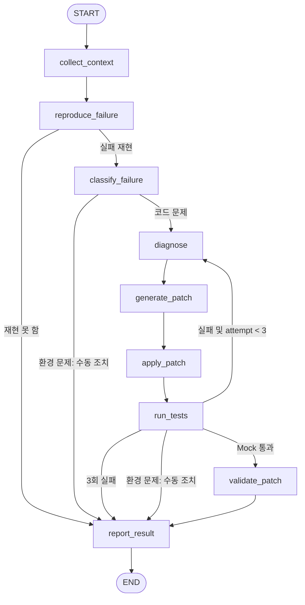

# PatchPilot Phase 1 아키텍처

`StateGraph(RepairState)`는 9개의 독립적인 노드를 연결한다. 각 노드는 상태의 부분 업데이트를 반환한다.
Pydantic으로 어댑터 반환값과 업데이트를 검증하고, 조건분기는 LLM 응답과 독립적인 실행 결과 및 정책에 따른다.
구성 방식은 [LangGraph Graph API](https://docs.langchain.com/oss/python/langgraph/graph-api)를 따른다.

모든 실행 노드의 어댑터 예외·스키마 검증 실패·정책 위반은 `failed`로 표시하고 `report_result`로 이동한다.
성공은 통과 결과 이후 `validate_patch`에서 수정 이력과 원본을 재적용한 파일이 현재 파일과 같고,
원본 대비 실제 변경이 존재함을 확인한 경우에만 기록한다. Mock 결과의 정확성을 검증하는 것은 아니다.

## 노드 책임

| 노드 | 역할 |
| --- | --- |
| `collect_context` | 실패 정보에 대한 파일 스냅샷 수집, 원본 보존 |
| `reproduce_failure` | runner로 재현 결과 확보; 통과하면 재현 실패 종료 |
| `classify_failure` | 구조화된 runner 결과로 환경/코드 문제 구분 |
| `diagnose` | LLM에 최신 실패 결과와 현재 파일, 이전 수정 이력 전달 |
| `generate_patch` | 시도 횟수 증가 후 LLM 제안을 구조화된 Patch로 검증 |
| `apply_patch` | 모든 파일 정책 및 이전 내용 확인 후 메모리에서 원자적 수정 |
| `run_tests` | 수정 후 Mock 결과 기록; 환경 오류 및 최대 실패 상태 설정 |
| `validate_patch` | 통과 결과, 변경 존재, 전체 수정 이력과 파일 일치 확인 |
| `report_result` | 상태·시도 횟수·변경 파일·Mock 표시·오류 보고 |

## 상태와 확장 지점

`RepairState`는 실패 정보, 원본/현재 파일, 재현 결과, 분류, 진단 이력, 현재 Patch,
적용 Patch 이력, 시도 횟수, 테스트 결과 이력, 최종 상태, 오류, 실행 trace와 보고문을 보존한다.
시도 횟수는 Pydantic의 0~3 범위와 실행 가드로 제한한다.
Phase 1은 매번 초기 상태에서 실행하며 체크포인트 재개를 지원하지 않는다.
3회 실패 루프에 필요한 전체 노드 실행 수를 고려해 데모 recursion limit은 40으로 지정한다.

`GitHubClient.collect_context`, `LLMClient.diagnose/generate_patch`, `TestRunner.run`을
Protocol로 분리한다. 주입된 어댑터는 그래프의 경로, 파일 정책, 재시도 제한을 결정하지 못한다.
수정 제안은 전체 파일의 `before`/`after` 문자열을 사용한다. 파일 생성·삭제와 diff parser는 추가하지 않는다.
시도 간에는 이전 메모리 수정이 유지되며, 다음 진단은 최신 결과와 누적 수정 이력을 받는다.
실패한 실행의 메모리 상태는 검토용으로 반환하지만 호스트나 원격 저장소에는 쓰지 않는다.

## 실제 결과와 Mock 결과 구분

Fake 어댑터는 네트워크, shell, subprocess, pytest 실행을 수행하지 않는다.
FakeTestRunner는 입력 파일과 무관하게 phase/attempt에 대응하는 설정 결과를 반환한다.
그래프의 결과 모델에는 `simulated: true`만 허용하며 CLI 보고도 이를 명시한다.
PatchPilot 자체의 `tests/`를 실행한 실제 pytest 결과만 개발 검증 결과로 보고한다.

다음 Phase의 실제 LLM 출력도 동일한 구조·정책 검사를 통과해야 한다.
실제 실행 전 격리된 runner, 리소스·시간 제한, 인증 정보 분리 및 실제 결과 출처 모델을 구현해야 한다.
메모리상의 경로 검사는 파일 시스템의 symlink 안전성을 보장하지 않으므로 별도 검증이 필요하다.
실제 GitHub 쓰기 메서드는 현재 인터페이스에 존재하지 않는다.
