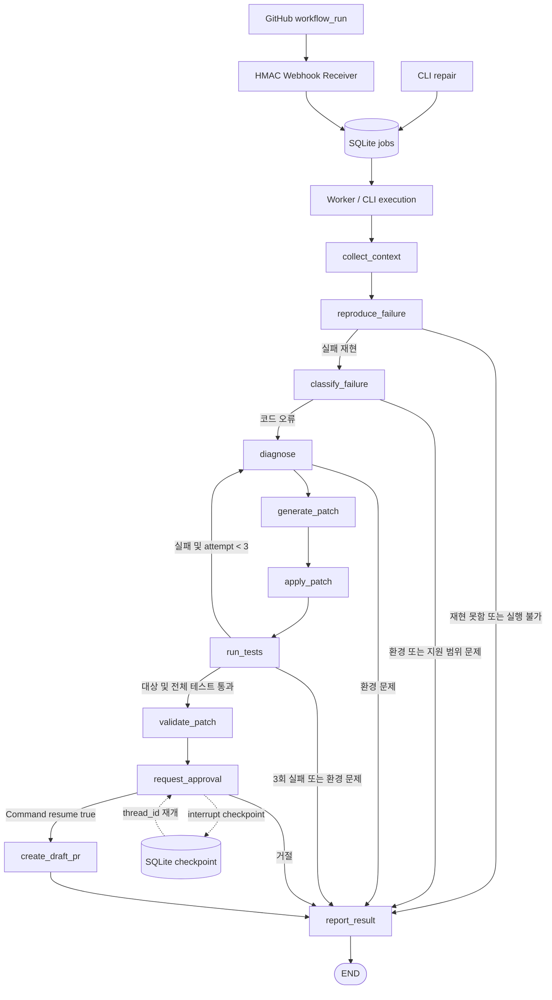

# MVP 아키텍처

CLI 또는 서명된 GitHub workflow_run 이벤트 → SQLite 작업 큐 → worker/CLI 실행 → LangGraph →
Docker 검증 → HITL 승인 → GitHub Draft PR → 정확한 SHA의 원격 CI 조회.
Mock 어댑터를 유지하고 Protocol 경계에서 실제 어댑터를 주입한다.

모든 실행 노드의 어댑터 오류·정책 위반은 보고로 종료한다. 승인 interrupt는 예외 handler 밖에 두어
LangGraph가 중단을 저장하게 한다. Mock 그래프는 승인/발행 노드를 사용하지 않고 기존 9개 노드를 유지한다.

## 상태 및 인터페이스

`RepairState`는 FailureInfo(Repo/Run/attempt/SHA/tree/blob/mode/failed job/log), 원본·현재 소스,
분류·진단·Patch 이력, 최대 3회 attempt, 재현 및 수정 TestResult, trace, Diff, 승인, PR URL,
발행 SHA, LLM 응답·사용량과 실행 시간을 기록한다. SecretStr 설정은 상태에 넣지 않는다.

- `GitHubClient.collect_context`: Git blob SHA를 검증한 소스 스냅샷. RealGitHubClient는 실패 Run의 메타데이터와 로그도 수집한다.
- `LLMClient.classify_failure/diagnose/generate_patch`: LangChain ChatOpenAI의 Pydantic Structured Output. 이전 실패 결과와 변경 이력을 전달한다.
- `TestRunner.run`: Fake는 scripted 결과, Docker는 격리된 대상/전체 pytest의 명령·exit·집계·출력과 workspace digest를 반환한다.
- `build_graph(..., checkpointer=..., publisher=...)`: 기존 노드와 경로를 재사용하고 실제 승인·발행만 확장한다.

## 실행 및 검증

GitHub Git tree/blob으로 정확한 SHA의 스냅샷을 읽는다. tar는 신뢰하는 파일명·문자열에서만 생성한다.
실행하지 않는 staging container에 Docker daemon이 임시 named volume으로 복사하고,
실제 테스트 container에는 그 볼륨만 read-only로 마운트한다. 호스트 bind mount와 Docker socket은 사용하지 않는다.
신뢰하는 harness가 고정 pytest config/plugin과 제한된 환경으로 대상·전체 pytest subprocess를 실행한다.
fixture나 외부 저장소의 Python은 호스트에서 import/실행하지 않는다.

실제 LLM은 파일마다 유일하게 일치하는 정확한 `before` 부분 문자열과 `after` 교체 문자열을 제안한다.
어댑터는 빈 문자열·누락·중복/모호한 일치·보호 경로를 거부하고, 원본 전체를 보존한 full-file Patch로 변환한다.
기존 실행 계층의 정확한 전체 `before`/`after`, 경로/AST/수정량 검사는 그대로 수행해 원자적으로 적용한다.
재시도 시 이전 패치는 유지하고 최신 결과와 모든 변경을 LLM에 전달한다.
최종 검증은 원본에서 Patch 이력을 재적용한 결과, 누적 제한, 원본/최종 digest,
실제 targeted/full 결과, 수집 테스트의 유지 및 신규 skip 금지를 독립적으로 확인한다.

## 영속성과 부작용

Job은 repository/Run/attempt 단위로 unique이며 thread_id는 job_id다. Delivery ID와 body hash도 별도 저장한다.
SQLite와 per-job 파일 락으로 여러 worker/CLI의 중복 실행을 막는다. Crash 후 RUNNING 작업은 저장된 그래프에서 재개한다.
체크포인트 역직렬화는 명시적으로 허용한 PatchPilot 상태 모델 타입으로 제한한다.
승인은 새 프로세스의 `Command(resume=True/False)`로 재개하며 테스트/LLM을 반복하지 않는다.

LLM 성공 응답은 모델/Temperature/Schema/Prompt/상태 해시로 캐시한다. 정상 재개는 캐시를 재사용하며
Timeout·잘못된 출력은 기록 후 종료한다. 원격 요청 성공 직후 캐시 저장 전 프로세스가 죽으면
LLM 요청/과금이 반복될 수 있어 exactly-once를 보장하지 않는다.

Git tree/commit은 동일한 내용·parent·message·identity/date로 생성한다.
Run/SHA로 결정한 repair branch의 기존 SHA가 다르면 덮어쓰지 않는다. attempt가 바뀐 재실행도 동일 PR을 재사용한다.
PR을 생성하기 전/충돌 시 기존 PR을 조회한다.
네트워크 실패 후 `PUBLISH_FAILED`는 같은 approve 명령으로 발행만 재시도할 수 있다.
사용자 승인 이전에는 write API를 호출하지 않는다. Base ref가 원본 SHA와 다르면 재수정을 요구한다.

## 평가 및 원격 CI

LOCAL_VERIFIED는 로컬 Docker 검증이다. CI_PENDING/VERIFIED/FAILED는 발행 SHA의 GitHub workflow 조회 결과다.
원본 workflow가 아직 없거나 관측된 workflow가 진행 중이면 pending, 하나라도 실패하면 failed다.
관측되지 않은 필수 checks의 존재나 branch protection 통과는 보장하지 않으며 자동 Merge는 지원하지 않는다.
Mock 결과는 실제 검증 성공 지표에 포함하지 않는다.

## 공식 API 참고

- [LangGraph Graph API](https://docs.langchain.com/oss/python/langgraph/graph-api)
- [LangGraph interrupt와 Command resume](https://docs.langchain.com/oss/python/langgraph/interrupts)
- [OpenAI Structured Outputs](https://developers.openai.com/api/docs/guides/structured-outputs)
- [LangChain ChatOpenAI](https://docs.langchain.com/oss/python/integrations/chat/openai)
- [GitHub Git Database API](https://docs.github.com/en/rest/guides/using-the-rest-api-to-interact-with-your-git-database)
- [GitHub Webhook 서명](https://docs.github.com/en/webhooks/using-webhooks/validating-webhook-deliveries)
- [Docker run 제한](https://docs.docker.com/engine/containers/run/)
