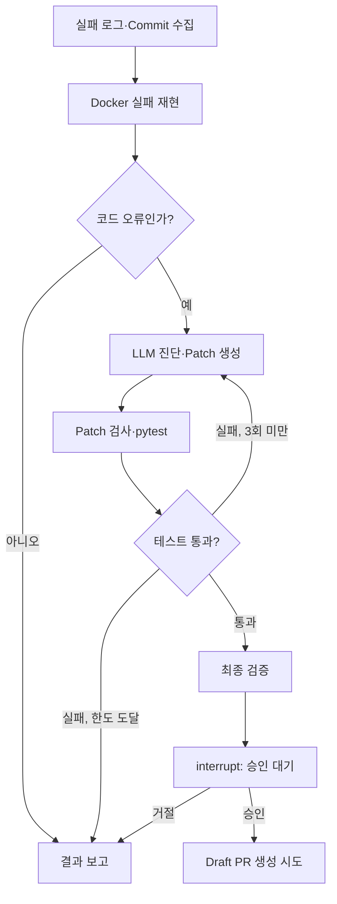

# PatchPilot — LangGraph 프로젝트 보고서

**주제:** 실패한 GitHub Actions CI를 진단·수정·검증하는 AI Agent  
**목적:** SKALA의 LangGraph 개념을 실제 개발 문제에 적용  
**검토 기준:** `ii2001/PatchPilot`, 2026-10-12 실험 및 GitHub 기록

## 1. 왜 이 서비스를 만들었는가?

개발자가 PR을 작성한 뒤 CI가 실패하면 실패 로그를 읽고 원인을 찾아 코드를 고친 후 다시 Push해야 한다. 문제가 한 번에 해결되지 않으면 이 과정이 반복된다.

**해결하고 싶은 문제는 ‘CI가 실패했다는 사실을 알려주는 것’이 아니라, 실패 원인 분석과 수정·재검증에 쓰이는 반복적인 개발자 작업이다.**

따라서 PatchPilot은 GitHub Actions의 실패 Run을 입력받아 **실제 오류 재현 → LLM 진단·패치 → pytest 재검증 → 사람의 승인**으로 이어지는 AI Agent로 설계했다. 새로운 범용 코딩 모델이 아니라, **작업 실행 흐름을 통제하는 시스템**을 구현한 것이다.

## 2. 왜 LangGraph인가?

단순한 `입력 → Prompt → LLM → 출력` 체인이라면 오류 설명은 가능하지만, **수정된 코드를 실제 실행하고 그 결과로 다음 행동을 바꾸는 과정**을 표현하기 어렵다.

PatchPilot의 요구사항을 LangGraph 기능에 연결했다.

| 핵심 요소 | 적용한 이유 | 구현 |
| --- | --- | --- |
| **`StateGraph`** | 수집·진단·패치·테스트를 독립 단계로 관리 | `graph.py` |
| **`RepairState`** | 이전 오류와 수정 이력을 다음 단계에 전달 | `state.py` |
| **Conditional Edges** | 오류 유형과 테스트 결과에 따라 실행 경로 선택 | `graph.py` |
| **Cycle (최대 3회)** | 실패한 수정 결과를 LLM에 다시 제공하되 무한 반복 방지 | `nodes.py` |
| **SQLite Checkpointer** | 사용자가 승인하기 전까지 실행 상태 유지 | `service.py` |
| **`interrupt / Command(resume)`** | AI의 코드 제안과 실제 원격 변경을 분리 | `graph.py / service.py` |



핵심은 **LLM이 실행 경로를 마음대로 결정하지 않는다는 점**이다. 분기·반복 한도·성공 판정은 그래프와 검증 코드가 담당한다.

## 3. 왜 이런 구현 방식을 선택했는가?

| 결정 | 선택한 이유 |
| --- | --- |
| **GitHub API + Commit SHA 고정** | 실패 당시 코드와 현재 브랜치 코드가 다를 수 있으므로 재현 대상을 고정 |
| **LLM Structured Output** | 자유 형식 설명보다 분류·원인·수정 파일/내용을 검증 가능한 데이터로 전달 |
| **코드 오류 / 환경 오류 구분** | Secret 누락·인프라 문제를 코드 변경으로 억지 해결하지 않도록 차단 |
| **Docker 기반 pytest** | 외부 저장소 코드를 호스트에서 실행하지 않고, 변경 전후 테스트의 실제 증거 확보 |
| **Patch 정책·최종 검증 분리** | LLM이 테스트 파일이나 CI 설정을 고치거나 성공 결과를 조작하지 못하도록 제어 |
| **Checkpointer + 사람의 승인** | 테스트가 통과해도 잘못된 변경일 수 있으므로 원격 GitHub 쓰기 전에 중단·검토 |
| **Mock Adapter 유지** | API 요금·인증 정보 없이 조건분기, 예외, 재시도, 승인 로직을 반복 테스트 |
| **CLI 중심 + 선택적 Webhook** | LangGraph 핵심 동작을 먼저 검증하고, 자동 감지는 추가로 연결 가능하게 설계 |

**실제 구현 범위:** Python 3.11+/pytest, 기존 소스 파일 수정, 기본 최대 3개 파일·100줄·3회 시도. Docker는 비특권 사용자·네트워크 차단·읽기 전용 소스·리소스 제한을 적용한다. 이는 위험을 줄이는 조치이지 완전한 보안 보장은 아니다.

## 4. 무엇을 구현하고 검증했는가?

### 4.1 테스트 계층을 구분한 이유

Mock 시뮬레이션만 통과한 결과를 “AI 자동 수정 성공”으로 표현하면 안 된다. 그래서 **코드의 분기 검증, 실제 Docker pytest, 실제 GitHub/OpenAI 실험, 원격 PR 발행**을 구분했다.

| 검증 단계 | 확인 결과 |
| --- | --- |
| **Unit/Mock** | 그래프 분기, 3회 제한, 안전 정책, 체크포인트·승인·GitHub API 요청 |
| **프로젝트 자체 CI** | [Actions #38215981498](https://github.com/ii2001/PatchPilot/actions/runs/38215981498): **134 passed / 13 skipped / 0 failed**, Mock 데모·패키지 빌드 성공 |
| **실제 AI 수정 실험** | [실패 Run #38213983578](https://github.com/ii2001/PatchPilot/actions/runs/38213983578)에서 실제 OpenAI 분석·수정과 Docker 재검증을 수행했다고 프로젝트 실험 기록에 명시 |
| **승인 후 Draft PR** | 원격 GitHub 쓰기 중 `Contents: write` 권한 부족으로 **HTTP 403**, 발행 미완료 |

### 4.2 실제 수리 실험과 그 의미

정상 `main`을 보호하기 위해 별도의 실습 브랜치에 `policy.py`의 **비교 연산자 오류**를 고의로 넣었고, GitHub Actions가 실제로 실패했다.

실습 기록([`docs/self-repair.md`](self-repair.md))에는 원본 Docker 재현에서 **대상 4 failed, 전체 22 failed / 104 passed / 13 skipped**가 기록되어 있다.

첫 Agent 실행에서는 LLM이 제안한 **부분 문자열 수정**을 프로그램이 **전체 파일의 원본**으로 잘못 해석해 Patch 검증을 통과하지 못했다. 이 불일치를 고쳐, 파일 내에서 유일하게 일치하는 수정 부분만 전체 파일 Patch로 변환하도록 개선했다.

이후 실제 OpenAI의 분류·진단·수정이 1회 패치 시도로 다음 변경을 생성했다.

```diff
-        if change.path not in files or files[change.path] == change.before:
+        if change.path not in files or files[change.path] != change.before:
```

수정 후 프로젝트 기록상 **Docker 대상 29 passed, 전체 126 passed / 13 skipped**가 확인됐고, LangGraph는 승인 대기까지 진행했다. 사용자 승인 후 실제 PR 발행은 GitHub Token의 쓰기 권한 문제로 멈췄다. **따라서 실제 수정 및 로컬 검증은 성공 사례가 있지만, 최종 Draft PR과 해당 PR의 원격 CI 성공은 아직 입증하지 못했다.**

이 경험은 **LLM 출력 형식과 실행 계층의 계약을 명확히 설계하는 것이 중요하다**는 것을 보여준다. 테스트 통과 이전에 Patch의 적용 가능성을 독립적으로 검증하는 이유이기도 하다.

## 5. 무엇을 배웠고, 무엇이 남았는가?

**학습 성과**

- **LangGraph가 필요한 이유:** LLM 호출 자체보다 **실행 결과에 따라 다시 분석하는 상태 기반 흐름**을 제어할 수 있었다.
- **State가 필요한 이유:** 실패 이력과 최신 파일 상태가 남아야 재시도에 의미가 있다.
- **결정론적 검증이 필요한 이유:** LLM의 제안만으로 테스트 통과나 수정의 안전성을 판단할 수 없다.
- **HITL이 필요한 이유:** 자동 검증과 실제 GitHub 원격 변경은 책임과 위험이 다른 작업이다.

**한계와 개선 방향**

- **실제 PR 발행 미검증:** 선택 저장소의 적절한 쓰기 권한으로 1회 검증할 필요가 있다.
- **LLM 컨텍스트 비효율:** 실제 한 줄 수정 기록에서 입력 **286,385 tokens**를 사용했다. 이후에는 실패 테스트·관련 파일 중심으로 줄일 필요가 있다.
- **적용 범위 제한:** 최대 200개 파일·1MB UTF-8 저장소의 Python/pytest 프로젝트 중심이며, 임의 의존성 설치·파일 추가/삭제·자동 Merge는 지원하지 않는다.
- **성공률 일반화 불가:** 실제 수정 실습은 한 사례이므로 다양한 실패 유형에서 정확도를 추가 측정해야 한다.

이 개선 사항들은 제품화 단계에서는 중요하지만, **LangGraph 학습 목표를 충족하기 위한 필수 기능은 아니다.**

## 6. 결론

PatchPilot은 **CI 실패 수집 → 오류 재현 → LLM 수정 → 실제 테스트 → 재시도 → 승인** 과정을 LangGraph로 구현한 학습형 AI Agent MVP다.

프로젝트의 의의는 자동 복구 기능이 처음이라는 데 있지 않다. **왜 상태를 저장해야 하는지, 왜 조건부로 반복해야 하는지, 왜 LLM 판단과 검증·승인을 분리해야 하는지**를 실제 코드와 실험으로 확인한 점에 있다.

---

**근거:** [README](../README.md) · [아키텍처](architecture.md) · [실제 복구 기록](self-repair.md) · [보안·지원 범위](security.md)
