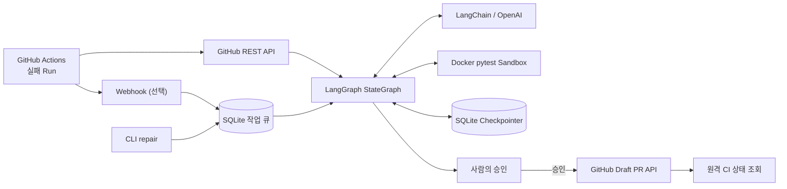
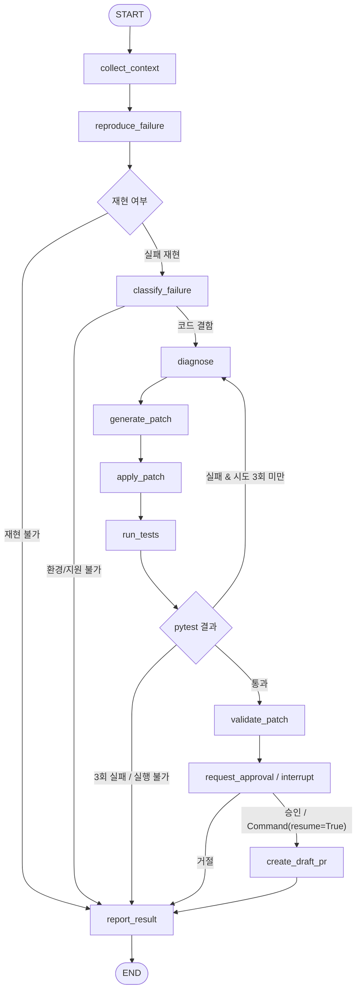

# PatchPilot 프로젝트 보고서

**부제:** LangGraph 기반 CI 실패 진단·수정·재검증 AI Agent 구현  
**프로젝트 유형:** SKALA AI Agent / LangGraph 학습형 개인 프로젝트  
**대상 버전:** `ii2001/PatchPilot`, `main` Commit `7b8c0c82ee03586f19c289e640e5089d27aa9770`  
**코드·실험 검토 기준일:** 2026-10-13 (GitHub Actions 및 저장소 기록은 2026-10-12)

> 이 보고서는 저장소의 실제 구현 파일과 GitHub Actions 기록, `docs/self-repair.md`의 실습 기록을 기준으로 작성했다. 코드에 구현된 기능과 실제 외부 서비스에서 최종 동작까지 검증된 기능을 구분한다.

## 1. 프로젝트 개요

### 1.1 문제 정의

GitHub Actions CI가 실패하면 개발자는 실패한 Job·Step을 열고 로그를 읽은 다음 소스코드를 수정하고 Push하여 결과를 기다린다. 이 과정은 동일한 유형의 Python/pytest 오류에서 반복되며, 수정 후 다시 실패할 경우 같은 과정을 재수행해야 한다.

PatchPilot은 이 작업을 다음과 같은 **상태 기반 Agent 워크플로**로 모델링했다.

1. 실패한 CI의 **정확한 Commit 및 로그**를 수집한다.
2. 격리된 Docker에서 실패를 재현한다.
3. LLM이 원인을 분류·진단하고 제한된 수정안을 제안한다.
4. Patch를 검증·적용한 뒤 실제 pytest를 재실행한다.
5. 테스트가 실패하면 이전 이력을 활용해 최대 3회 재시도한다.
6. 통과한 결과를 저장하고 사람의 승인 이후에만 GitHub Draft PR 생성을 시도한다.

### 1.2 목표와 범위

| 구분 | 내용 |
| --- | --- |
| **학습 목표** | LangGraph의 StateGraph, 조건 분기, Cycle, Checkpointer, HITL을 실제 문제에 적용 |
| **기능 목표** | Python/pytest CI 오류의 자동 진단·수정·실행 검증 |
| **안전 목표** | 테스트·CI 파일 변조 차단, 격리 실행, 승인 전 원격 쓰기 금지 |
| **검증 목표** | Mock 단위 테스트와 실제 Docker·GitHub CI·OpenAI 수행 결과 구분 |
| **제외 범위** | 범용 언어 지원, 자동 Merge, GitHub App 설치형 UX, 대규모 분산 운영 |

기존 Copilot 및 CI 자동 수리 서비스와 유사한 문제 영역을 다룬다. 프로젝트의 핵심 기여는 **기능 자체의 최초 발명보다는 LangGraph 기반 실행 제어·검증·승인을 구체적으로 구현하고 시험한 것**이다.

## 2. 핵심 요구사항과 구현 대응

| ID | 요구사항 | 구현 근거 | 검증 범위 |
| --- | --- | --- | --- |
| FR-01 | 실패 Run의 로그·Commit SHA 조회 | `github.py: load_failure, collect_context` | Mock REST + 실제 Run 실습 |
| FR-02 | 실패 원본의 Docker 재현 | `docker_runner.py` + `docker/runner.py` | 실제 Docker 통합 테스트 |
| FR-03 | 오류 유형 분류·진단 | `llm.py` + `nodes.py` | Structured Output 테스트 + 실습 기록 |
| FR-04 | 최소 수정 Patch 생성·검사 | `llm.py` + `policy.py` | 정책·원문 일치·AST 테스트 |
| FR-05 | 수정 후 대상·전체 pytest | `nodes.py: run_tests` + `verification.py` | Docker 통합·실습 기록 |
| FR-06 | 최대 3회 조건부 재시도 | `graph.py: after_tests` | Mock / Docker 시나리오 |
| FR-07 | 실행 중단·재개·승인 | `graph.py: interrupt` + `service.py` | SQLite 체크포인트 통합 테스트 |
| FR-08 | 승인 후 Draft PR 제안 | `github.py: create_draft_pr` | Mock REST 성공, 실제 API는 403에서 중단 |
| FR-09 | 선택적 실패 이벤트 자동 수신 | `webhook.py` + `storage.py` | HMAC·중복 처리·로컬 HTTP 통합 |
| NFR-01 | 결과 출처·보안·멱등성 | `state.py` / `policy.py` / `verification.py` | 단위·통합 테스트 |

각 파일은 [저장소 코드](../src/patchpilot/)에서 확인할 수 있다.

## 3. 시스템 아키텍처

### 3.1 전체 구조



서비스는 **CLI 수동 실행**과 **Webhook + Worker 자동 접수**를 모두 지원한다. Webhook은 이벤트를 영속 큐에 넣고, 실제 수리 작업은 별도 프로세스가 실행한다.

### 3.2 LangGraph 실행 구조



실제 코드의 노드 배치·조건 라우팅은 [`graph.py`](../src/patchpilot/graph.py), 세부 실행은 [`nodes.py`](../src/patchpilot/nodes.py)에 구현되어 있다. 오류가 발생하면 안전하게 보고 단계로 종료한다. 발행 후 실패 시에는 승인 정보를 보존하고 `PUBLISH_FAILED`로 처리한다.

### 3.3 공유 상태(RepairState)

[`state.py`](../src/patchpilot/state.py)의 `RepairState`는 Pydantic 모델이다.

| 필드/모델 | 저장 내용 | 필요 이유 |
| --- | --- | --- |
| `FailureInfo` | repo, Run ID/attempt, head_sha, tree/blob, 실패 로그 | 특정 실패 원본의 재현성과 추적 |
| `original_files / files` | 원본 및 현재 코드 스냅샷 | Patch 적용·비교·무결성 |
| `reproduction / test_results` | 실제/Mock 여부, 실행 명령·Exit Code·집계·Digest | 테스트 결과 위조·혼용 방지 |
| `diagnoses / applied_patches` | 이전 원인 분석과 변경 이력 | 재시도 피드백과 변경 추적 |
| `attempt` | 시도 횟수 (0~3) | 무한 루프 방지 |
| `status / approved` | 실행 상태 및 명시적 승인 결과 | 상태별 조건부 제어 |
| `diff / pr_url / published_sha` | 제안 변경·발행 정보 | 사용자 검토와 원격 검증 |
| `llm_calls / elapsed_seconds` | 모델 호출·사용량·실행 시간 | 평가 및 운영 기록 |

### 3.4 왜 단순 Chain 대신 LangGraph인가?

일회성 LLM 호출은 입력→응답을 생성하지만, PatchPilot은 **코드 실행의 결과에 따라 다시 LLM 분석으로 되돌아가야 하는 Cycle**이 핵심이다.

- **Conditional Edges:** 테스트 결과·실패 유형·시도 횟수로 다음 노드를 결정한다.
- **State:** 이전 실패 출력 및 패치 이력을 다음 진단에 전달한다.
- **Checkpointer:** 사용자 승인 전 중단 상태를 SQLite에 저장한다.
- **HITL:** `interrupt()` 후 별도 CLI 프로세스에서 `Command(resume=True/False)`로 재개한다.
- **결정론적 통제:** 모델은 Patch를 제안할 뿐 파일 보호 정책·pytest 성공 판정·실제 발행 승인 권한을 갖지 않는다.

이 설계는 단순히 LLM을 여러 번 호출한 것이 아니라 **실패→피드백→재수정→검증**의 제어 흐름을 구현했다는 점에서 LangGraph 학습 목표와 직접 연결된다.

## 4. 핵심 구현

### 4.1 GitHub 실패 수집

`RealGitHubClient`는 완료된 실패 Workflow Run에서 실패 Job·Step 및 로그를 조회한다. `head_sha`의 Git Tree와 Blob을 확인하고 내용 해시를 검증하여 실행 대상 소스가 원본 Commit과 일치하도록 처리한다. 허용 저장소 목록과 분기 조건을 확인하며 fork Run과 PatchPilot 복구 브랜치는 지원 대상에서 제외한다.

### 4.2 LLM 분류·진단·Patch 제안

`RealLLMClient`는 LangChain `ChatOpenAI`와 Pydantic Structured Output을 이용한다. 세 가지 작업(오류 분류 / 원인 진단 / 패치 제안)을 분리하고, 재시도 시 이전 수정 결과를 전달한다.

모델의 수정 제안은 특정 기존 파일에서 **유일하게 일치하는 `before` 부분 문자열**과 `after` 교체 문자열로 표현한다. 어댑터가 이를 기존 파일의 전체 문자열 변경으로 변환한 뒤 정책에서 다시 검사한다. 원본 불일치, 중복 수정, 보호 경로, 잘못된 Python AST 등은 거부한다.

### 4.3 Docker Sandbox와 테스트 검증

실제 외부 코드 실행은 호스트 Python에서 하지 않는다. `DockerTestRunner`는 실행 전 Linux Docker 지원·이미지 ID·seccomp·리소스 제한 등을 확인하고, 소스를 임시 Docker 볼륨에 복사해 **읽기 전용**으로 마운트한다.

대표 제한: 비특권 사용자(UID 65532), 네트워크 비활성화, Read-only Root FS, capability 제거, CPU/메모리/PID/시간 제한, Secret 및 Docker Socket 미전달. 신뢰한 `docker/runner.py`에서 대상 pytest와 전체 pytest를 실행하며 각 단계의 실제 결과·Workspace Digest를 반환한다.

`verification.py`는 테스트 통과 표시만 신뢰하지 않고, 패치 이력 재적용·수정 파일/줄 수·Digest·최소 실행 증거·수집된 테스트 유지·신규 Skip 방지 등을 검사한다.

### 4.4 사람의 승인과 원격 발행

`request_approval` 노드는 `interrupt()`로 멈춘다. 사용자는 `patchpilot status`로 Diff를 확인하고 `approve` 또는 `reject`를 호출한다. 승인 시 GitHub Git Database API로 tree/commit/ref를 생성한 뒤 **새 Draft PR을 제안**한다. 동일 Run/SHA에 대한 중복 브랜치·PR 생성도 방지하려고 설계했다.

중요하게, 현재 구현은 **기존 PR에 직접 추가 Commit을 Push하는 Auto-Heal 모드가 아니다.** 기존 기준 브랜치에 대한 별도 Draft PR을 생성하는 방식이다. 실제 PR 발행 성공 여부는 아래 검증 결과와 분리해서 평가해야 한다.

### 4.5 영속성·자동 이벤트 처리

`JobStore`는 SQLite의 Job·Webhook Delivery·LLM 응답 캐시를 관리하고, 파일 락으로 동일 Job의 중복 실행을 제한한다. Webhook은 서명을 검증해 이벤트만 등록하고 Worker가 실제 Agent를 수행한다. 로컬 사용자 승인은 재시작 후 `thread_id`를 사용해 체크포인트에서 재개한다.

## 5. 구현 구성과 폴더 구조

```text
PatchPilot/
├── src/patchpilot/
│   ├── state.py / graph.py / nodes.py  # LangGraph 상태·노드·분기
│   ├── llm.py / github.py              # LLM, GitHub REST 어댑터
│   ├── docker_runner.py                # 격리 pytest
│   ├── policy.py / verification.py     # Patch·최종 검증
│   ├── service.py / storage.py         # CLI 실행, Checkpoint·Queue
│   ├── webhook.py / reporting.py       # 이벤트·결과
│   └── adapters.py / scenarios.py      # Mock 실행과 인터페이스
├── docker/                             # 신뢰하는 Sandbox harness
├── tests/                              # 8개 테스트 모듈
├── examples/failing_pytest_demo/       # Assertion/Syntax/Import/Environment 실습
├── .github/workflows/ci.yml           # 실제 프로젝트 CI
├── docs/                               # 아키텍처·보안·검증·본 보고서
└── README.md / pyproject.toml
```

서비스 구현을 책임별로 분리했으며, Phase 1 Fake 어댑터는 LangGraph 흐름을 외부 API 비용 없이 재현하기 위해 유지한다.

## 6. 테스트 설계와 결과

### 6.1 검증 계층 구분

| 계층 | 검증하는 내용 | 증거 |
| --- | --- | --- |
| Unit/Mock | 그래프 분기·최대 3회·정책·LLM 구조화·GitHub API 요청 | `tests/test_*.py` |
| Docker 통합 | 실제 pytest 실행, 복구·재시도·Timeout·격리, 승인 상태 재개 | `tests/test_docker_integration.py` |
| GitHub 프로젝트 CI | 설치, 회귀 테스트, Mock 데모, 패키지 빌드 | [Actions #38215981498](https://github.com/ii2001/PatchPilot/actions/runs/38215981498) |
| 실제 Agent 수리 | GitHub 실패 Run → 실제 OpenAI → Docker 수정 검증 | [self-repair 기록](self-repair.md) |
| 승인 후 원격 PR | 실제 GitHub Git Database write 및 수정 PR의 CI | **권한 부족으로 미완료** |

### 6.2 GitHub Actions 확인 결과

2026-10-12의 `main` Push [GitHub Actions #38215981498](https://github.com/ii2001/PatchPilot/actions/runs/38215981498)에서 실제 로그상 **134 passed, 13 skipped, 0 failed**가 확인된다. 또한 Mock 데모 실행과 sdist/wheel 빌드 단계가 성공했다.

13개 Skip은 기본 CI에서 명시적 opt-in이 필요한 Docker·Live API 테스트를 실행하지 않았기 때문이다. 초기 [`docs/validation.md`](validation.md)에는 **Docker opt-in 132 passed / 2 skipped**라는 이전 시점 결과가 있고, 이후 테스트 코드가 추가되어 최신 기본 CI 수치가 달라졌다. 두 수치를 동일한 실행으로 합산해서는 안 된다.

### 6.3 실제 실패 수리 실험

실습 대상: 동일 저장소의 **`test/self-repair-policy-20261012` 브랜치**. 정상 `main` 코드는 유지했다.

- **실제 CI 실패:** [Run #38213983578](https://github.com/ii2001/PatchPilot/actions/runs/38213983578), 실패 SHA `b64e8c7dbd1922e526c1aefd5c208e395880b269`.
- **주입한 결함:** `src/patchpilot/policy.py`에서 기존 소스 일치 검사 비교 연산자를 반대로 변경.
- **실패 재현:** 프로젝트 기록상 Docker 대상 **4 failed**, 전체 **22 failed / 104 passed / 13 skipped**.
- **첫 시도에서 발견한 문제:** 실제 LLM이 부분 문자열을 제안했으나 어댑터가 전체 파일 `before`로 해석해 Patch를 거부함. 이후 유일한 부분 문자열 치환으로 보완.
- **재실행:** 동일 실패 Run의 attempt 2에서 실제 OpenAI 모델(기록된 설정: `gpt-6-luna`)이 분류·진단·수정 수행.
- **수정 결과:** 파일 1개, 한 줄, 패치 시도 1회, LLM 호출 3회. 변경은 다음과 같음.

```diff
-        if change.path not in files or files[change.path] == change.before:
+        if change.path not in files or files[change.path] != change.before:
```

- **Docker 수정 후 재검증:** 대상 **29 passed**, 전체 **126 passed / 13 skipped**.
- **LangGraph 최종 상태:** `AWAITING_APPROVAL`까지 저장 후 사용자가 승인.
- **원격 발행 결과:** GitHub `POST /git/trees` 호출이 **HTTP 403** (`contents=write` 권한 요구)으로 차단되어 `PUBLISH_FAILED`. **실제 Draft PR이 발행되거나 수정 PR의 CI가 통과했다는 증거는 없음.**

수치와 실제 OpenAI/Docker 단계는 [프로젝트 내부 실험 일지](self-repair.md)에 기록된 실행 결과다. 반면 GitHub Actions 성공·실패 상태는 공개 원격 기록에서도 확인된다.

### 6.4 수치 해석 및 신뢰도

**확인된 사실:** CI에서 의도적으로 발생시킨 실제 실패 Run이 존재하며, 수정 후 로컬 Docker 테스트를 통과한 기록이 있다. LangGraph 재시도·승인 절차도 테스트 및 실습으로 검증했다.

**입증하지 못한 주장:** GitHub에 대한 발행이 끝까지 성공했다는 주장, 모든 Python 프로젝트에 적용 가능하다는 주장, AI 수리 성공률이 높다는 주장, 테스트 통과가 기능적·의미적으로 완전한 정답이라는 주장.

실제 수리 로그에는 **입력 286,385 tokens / 출력 481 tokens**가 기록된다. 파일 수·컨텍스트를 통째로 전달하는 방식의 비용·지연 최적화가 향후 중요한 과제라는 뜻이다. 이는 1건의 측정값이지 평균 비용이나 일반적 성공률이 아니다.

## 7. 안전성과 설계상 한계

| 항목 | 현재 정책 또는 한계 |
| --- | --- |
| Repo 허용 | `PATCHPILOT_ALLOWED_REPOS` 목록으로 제한 |
| 원본 일치 | 정확한 Commit SHA 및 Git blob·Workspace Digest 확인 |
| 코드 변경 | 기존 Python 파일만, 기본 3개 파일 / 100줄 / 3회 |
| 보호 대상 | tests, .github, .git, pytest 설정과 알려진 검증 우회 |
| Sandbox | Docker network none, read-only FS, 비특권 실행 및 자원 제한 |
| 사용자 승인 | 원격 쓰기 전에 HITL 필수, 자동 Merge 미지원 |
| 지원 환경 | 200개 파일 / 1 MB UTF-8 텍스트 저장소, Python 3.11+ pytest |
| 제외 기능 | 임의 dependency 설치, Secret 필요 테스트, Symlink/Binary/Submodule, 범용 GitHub App |
| 보안 한계 | Docker 격리·정적 검사만으로 악성 코드의 모든 우회를 막지는 못함 |

운영 환경에서는 검토한 고정 이미지와 별도 실행 호스트가 필요하다. 자세한 내용은 [보안 문서](security.md)를 따른다.

## 8. 재현 및 시연 방법

### 8.1 키 없이 LangGraph 동작 확인

```bash
python3 -m venv .venv
source .venv/bin/activate
pip install -e ".[dev,webhook]"
python -m patchpilot demo
pytest -q
```

### 8.2 실제 Docker 테스트

```bash
docker build -t patchpilot-sandbox:local docker
export PATCHPILOT_SANDBOX_IMAGE="$(docker image inspect patchpilot-sandbox:local --format '{{.Id}}')"
PATCHPILOT_RUN_DOCKER_TESTS=1 pytest -q -m docker
```

### 8.3 GitHub 실패 Run 대상으로 실행

별도의 테스트 저장소 또는 [자체 저장소 가이드](self-repair.md)처럼 안전한 실습 브랜치를 사용한다. 환경변수 `GITHUB_TOKEN`, `OPENAI_API_KEY`, `PATCHPILOT_OPENAI_MODEL`, `PATCHPILOT_ALLOWED_REPOS`, `PATCHPILOT_SANDBOX_IMAGE`가 필요하다.

```bash
patchpilot repair --repo owner/repo --run-id FAILED_RUN_ID
patchpilot status --job-id JOB_ID
patchpilot approve --job-id JOB_ID
patchpilot status --job-id JOB_ID
```

실제 승인과 GitHub API 쓰기 작업은 허용된 실습 저장소에서만 수행한다.

## 9. 프로젝트를 통해 확인한 점과 개선 계획

### 9.1 학습 성과

1. **LangGraph는 실행 제어를 명시적으로 구현하기 위한 도구:** LLM이 임의로 다음 단계를 정하도록 하지 않고 테스트·상태를 기준으로 경로를 결정했다.
2. **반복 수리에는 상태 이력이 필수:** 실패 로그, 현재 소스, 이전 패치를 다음 시도에 연결했다.
3. **HITL은 기능이 아니라 신뢰 경계:** 코드 수정 제안 및 로컬 검증과 실제 GitHub 원격 쓰기를 분리했다.
4. **검증 결과의 출처 관리:** Mock, 로컬 Docker, 원격 GitHub CI를 같은 성공 지표로 취급하지 않도록 모델을 분리했다.
5. **실제 실습에서 설계 결함이 드러남:** LLM의 snippet 출력과 실행 계층의 full-file Patch 기대 사이의 불일치를 발견·수정했다.

### 9.2 후속 개선 우선순위

| 우선순위 | 개선 항목 | 이유 |
| --- | --- | --- |
| 1 | 실제 Draft PR 및 수정 PR 원격 CI 1회 검증 | 현재 `Contents: write` 권한 문제로 발행 단계 미검증 |
| 2 | LLM 컨텍스트 축소(실패 테스트·관련 파일·로그 중심) | 단일 한 줄 수리에 입력 토큰 28만 개 이상 기록 |
| 3 | 기존 PR 브랜치에 안전하게 수정하는 모드 검토 | 현재는 새로운 Draft PR을 만드는 구조 |
| 4 | 작은 Python 프로젝트 여러 건으로 평가셋 구축 | 단일 성공 사례만으로 성공률 일반화 불가 |
| 5 | 문서 및 Docker 환경의 재현성 고도화 | 대상 의존성이 다른 프로젝트로 확대 시 필요 |

이 중 1~5번은 **현재 LangGraph 학습 프로젝트의 제출을 위한 필수 요구사항으로 간주하지 않는다.** 목표를 서비스 운영·배포로 확대할 때 검토할 후속 과제다.

## 10. 결론

PatchPilot은 LangGraph의 `StateGraph`·조건 분기·반복 실행·체크포인트·`interrupt()/Command(resume)`를 실제 GitHub CI 문제에 적용한 AI Agent MVP다. 최신 자체 GitHub Actions에서는 **134 passed / 13 skipped**를 확인했고, 실제 CI 실패를 OpenAI로 진단해 Docker pytest를 통과시킨 실습도 기록했다.

**프로젝트 평가:** LangGraph 학습·구현·시연 목적은 충족하는 것으로 판단한다. 다만 실제 승인 후 GitHub Draft PR 발행과 원격 CI 통과는 미검증이며, 이 부분까지 완전히 동작한 서비스로 서술해서는 안 된다.

## 11. 근거 자료

- [소스코드 및 README](../README.md)
- [LangGraph 아키텍처](architecture.md)
- [실제 CI 자동 수리 일지](self-repair.md)
- [MVP 초기 Docker·Mock 검증 기록](validation.md)
- [보안·지원 범위](security.md)
- [main GitHub Actions 성공 — Run #38215981498](https://github.com/ii2001/PatchPilot/actions/runs/38215981498)
- [의도적으로 실패시킨 CI — Run #38213983578](https://github.com/ii2001/PatchPilot/actions/runs/38213983578)
- [LLM snippet Patch 개선 PR #3](https://github.com/ii2001/PatchPilot/pull/3)
- [LangGraph 공식 문서](https://docs.langchain.com/oss/python/langgraph/overview)
